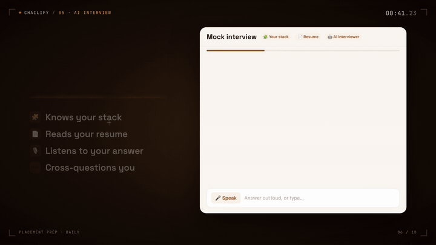
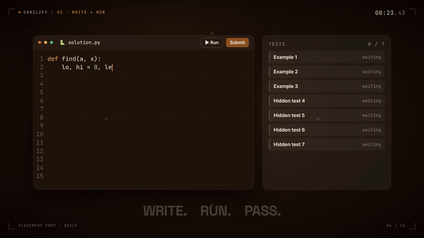

<!-- Header -->
<p align="center">
  
</p>

<p align="center">
  <a href="https://github.com/NishchalTharayil">
    
  </a>
</p>

<p align="center">
  <a href="https://nishchaltharayil.github.io"></a>
  <a href="https://www.linkedin.com/in/nishchalts"></a>
  <a href="mailto:nishchaltharayil2001@gmail.com"></a>
  <a href="https://chailify.pages.dev"></a>
</p>

---

## 👋 About me

```python
class Nishchal:
    role      = "Software Engineer"
    based_in  = "Bengaluru, India 🇮🇳"
    stack     = ["Python", "Django", "Angular", "MongoDB", "Redis", "Kafka"]
    started   = "Java + Spring Boot  →  switched to Python in July 2024"
    shipped   = {"work items": 362, "features owned": 62, "bugs fixed": "140+", "releases": "10+"}
    owns      = ["IPAM", "Attendance module", "Cisco SD-WAN polling", "Topology engine"]
    building  = "Chailify ☕  →  chailify.pages.dev"
    also      = "Wrote and published a romance novel 📖"
    open_to   = ["backend", "full-stack", "network software"]
```

- 🔧 I like the parts where software meets real hardware: making a **firewall, an SD-WAN controller or a hypervisor** report cleanly into one dashboard.
- 🧩 I own modules end to end, from the Django model to the Angular screen to the Excel report someone downloads at 9 AM.
- ☕ In my own time I build **Chailify**, a free placement-prep app for students and developers.

---

## ☕ Featured: [Chailify](https://chailify.pages.dev) · *Simplify with chai*

<table>
<tr>
<td width="55%" valign="top">



</td>
<td width="45%" valign="top">


**One free app for placement prep, from your first line of code to your offer letter.**

- 🎙️ **AI mock interviews** that know your stack and resume, listen to your answer and **cross-question you**, then give a score and a strong answer for every question
- 💻 **Write and run Python in the browser**, with tests, levels and daily problems
- 🐙 **One click to GitHub**: every solved problem lands in *your* repo
- ⏱️ Track your 24 hours, aptitude every day, weekly mock tests, reports
- ✈️ Telegram nudges at 9 AM (your plan) and 9 PM (your checklist)

<a href="https://chailify.pages.dev"><b>▶ Try it live: chailify.pages.dev</b></a>

</td>
</tr>
</table>

<p align="center">
  
  
  
  
  
  
  
  
  
  
</p>

<details>
<summary><b>💻 See the in-browser editor in action</b></summary>
<br />
<p align="center"></p>
</details>

---

## 🛠️ What I work with

<p align="center"><b>Every day</b></p>
<p align="center">
  <a href="https://skillicons.dev"></a>
</p>

<p align="center"><b>Also comfortable with</b></p>
<p align="center">
  <a href="https://skillicons.dev"></a>
</p>

<p align="center">
  
  
  
  
  
  
</p>

---

## 🗺️ The journey so far

| When | What |
|---|---|
| **2019 – 2023** | B.E. Computer Science, GM Institute of Technology · *Best Project Implementation 2022–23* (EasyNBA) |
| **2023** | Java full-stack internship · Spring Boot, React · built [TuneHub](https://github.com/NishchalTharayil/TuneHub) |
| **Jul 2024** | Joined a Python product team (Python · Django · Angular) and learned the stack on live tickets |
| **Oct 2024** | First feature shipped: OIDC single sign-on configuration UI · took over **IPAM** |
| **Mar 2025** | Built the **attendance module** end to end (geofencing, approvals, daily Excel reports) |
| **Oct 2025** | Multi-tenant **Cisco SD-WAN** polling · Fortinet HA, Proxmox, Aruba ClearPass |
| **2026** | Kafka trap sync, Redis caching, topology rules · launched **[Chailify](https://chailify.pages.dev)** ☕ |

---

## 📊 GitHub stats

<p align="center">
  
  
</p>

<p align="center">
  
</p>

---

## 📖 Off the keyboard

I wrote and published a romance novel, ***Somewhere, Somehow and Some-One***. Writing a book takes the same things as shipping a feature: a plan, hundreds of small drafts, and the patience to see it through to the last page.

---

<p align="center">
  
</p>

<p align="center">
  
</p>
